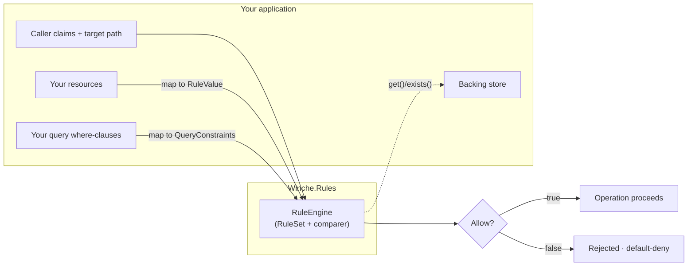
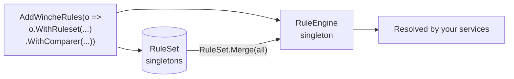
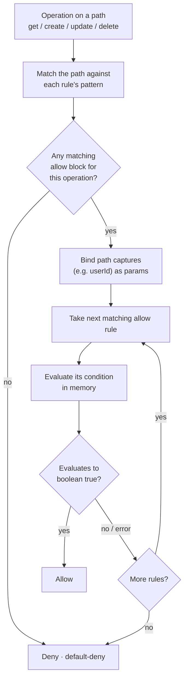
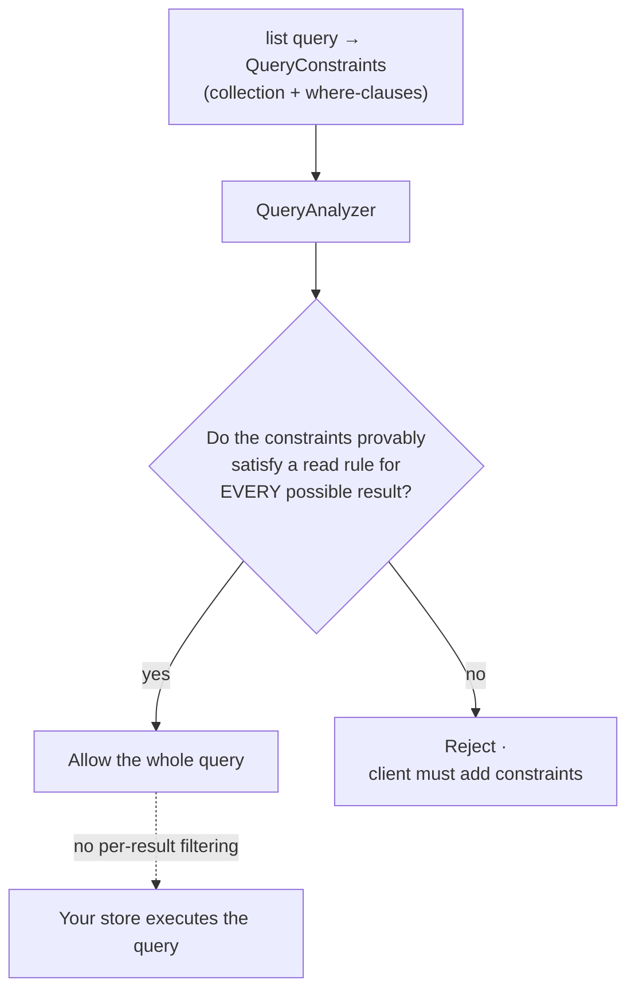

# Winche.Rules

[](https://www.nuget.org/packages/Winche.Rules)

A **standalone, declarative, JSON-serializable authorization rules engine** for .NET. You define access rules for path-based resources in C# (or load them as data from JSON), and the engine evaluates them **in memory** — no backend call required. It is **backend-agnostic**: you connect it to your own resource store and query model through small adapter ports. Winche.Rules powers Winche.Database's access control, but it carries no dependency on that library and can be used in any .NET project that authorizes resources addressed by path against per-request caller claims.

A "resource" here is anything you can address by a path — a record, a file, a row, an object — represented to the engine as a map of fields.

---

## Contents

1. [Core ideas](#core-ideas)
2. [How it works](#how-it-works)
3. [The value model](#the-value-model-rulevalue)
4. [Defining rules](#defining-rules-rulesetbuilder--expr)
5. [The engine](#the-engine-ruleengine)
6. [Dependency injection](#dependency-injection-addwincherules)
7. [Evaluating single-resource operations](#evaluating-single-resource-operations)
8. [Authorizing queries (list)](#authorizing-queries-list)
9. [Cross-resource conditions (get / exists)](#cross-resource-conditions-get--exists)
10. [Comparison semantics](#comparison-semantics-irulevaluecomparer)
11. [Rules as data (JSON)](#rules-as-data-json)
12. [Pluggability — connecting your project](#pluggability--connecting-your-project)
13. [Composing rulesets](#composing-rulesets)
14. [Public API reference](#public-api-reference)
15. [Requirements and license](#requirements-and-license)

---

## Core ideas

Winche.Rules implements a declarative, path-based authorization model.

**Allow-only, default-deny, OR semantics.** Every rule is an `allow` — there is no `deny`. If no `allow` rule matches and evaluates to `true`, the operation is rejected. When multiple rules match a path, access is granted if *any one* of them evaluates to `true`.

**Rules are not filters.** This is the most important design point for `list`/query operations. The engine does **not** silently remove resources from a result set. Instead, it analyzes the query's constraints *before* execution and asks: "Does this query's shape provably guarantee that every result satisfies a read rule?" If yes, the query is allowed. If not, the query is **rejected** and the client must add the necessary constraints. This is the `QueryAnalyzer`, and it is *sound*: it only allows queries it can prove safe; it rejects anything it cannot prove, including rules that use `get()`/`exists()`, ternaries, or `in`.

**Single-resource operations** (`get`, `create`, `update`, `delete`) are evaluated by loading the resource and running the condition **in memory**. The engine never touches your backing store on its own; you hand it the pre-loaded resource.

**Evaluation semantics.** A condition grants only when it evaluates to boolean `true`. Any other outcome — a missing field, a type mismatch, null navigation — denies rather than throws. Errors are swallowed by the evaluator (fail-closed semantics).

---

## How it works

The engine sits between your application's request and your backing store. You adapt your types into the engine's neutral inputs; it returns an allow/deny decision.



---

## The value model (`RuleValue`)

Everything the engine touches is a `RuleValue` — a neutral, JSON-ish value independent of any storage type. A resource is a `RuleValue.Map` of field names to values.

```csharp
using Winche.Rules;

// Scalar factories
RuleValue.Null
RuleValue.Bool(true)
RuleValue.Int(42L)
RuleValue.Double(3.14)
RuleValue.String("hello")
RuleValue.Bytes(byteArray)
RuleValue.Timestamp(DateTimeOffset.UtcNow)
RuleValue.Path("users/u1")

// Collections
RuleValue.List(new[] { RuleValue.String("a"), RuleValue.String("b") })
RuleValue.Map(new Dictionary<string, RuleValue>
{
    ["name"]  = RuleValue.String("Alice"),
    ["age"]   = RuleValue.Int(30),
})
```

`RuleValueKind` enumerates all kinds: `Null`, `Bool`, `Int`, `Double`, `String`, `Bytes`, `Timestamp`, `Path`, `List`, `Map`.

Numbers compare across `Int`/`Double` by numeric value. Comparison across other kinds is undefined and denies. (The exact equality/ordering rules are pluggable — see [Comparison semantics](#comparison-semantics-irulevaluecomparer).)

---

## Defining rules (`RulesetBuilder` + `Expr`)

### RulesetBuilder

Rules are built with the fluent `RulesetBuilder.Build` API, which returns a `RuleSet`. Each `Match` takes a path pattern and a configuration callback. Patterns support:

- **Literal segments** — `users`
- **Single-segment capture** — `{userId}` (binds one path segment to a param)
- **Recursive capture** — `{doc=**}` (must be the last segment; matches the rest of the path at any depth — the current path itself *and* everything beneath it)

`Allow` takes a set of operations and a condition expression. Use `RuleOperations.Read` (= `get` + `list`), `RuleOperations.Write` (= `create` + `update` + `delete`), `RuleOperations.All`, or `RuleOperations.Of(...)` for an explicit set.

```csharp
using Winche.Rules;
using Winche.Rules.Expressions;

RuleSet rules = RulesetBuilder.Build(r =>
    r.Match("users/{userId}", u =>
    {
        // Owner can read their own resource
        u.Allow(RuleOperations.Read,  Expr.Resource("data", "ownerId").Eq(Expr.Auth("uid")));
        // Owner can write (create/update/delete) to their own path
        u.Allow(RuleOperations.Write, Expr.Auth("uid").Eq(Expr.Param("userId")));

        // Nested match — public posts under each user
        u.Match("posts/{postId}", p =>
            p.Allow(RuleOperations.Read, Expr.Const(true)));
    }));
```

### The `Expr` vocabulary

`Expr` is a static fluent factory for building condition expressions (all nodes derive from `RuleExpression`).

**Roots**:

| Factory | What it maps to |
| - | - |
| `Expr.Resource(...)` | `resource` then the given field path — the **existing** resource |
| `Expr.Request(...)` | `request` then the given path |
| `Expr.RequestResource(...)` | `request.resource` then the given path — the **incoming** (post-write) resource |
| `Expr.Auth(...)` | `request.auth` then the given path — caller claims (`uid`, `token.role`, …) |
| `Expr.Param("userId")` | A path-capture variable (`{userId}` from the match pattern) |
| `Expr.Time()` | `request.time` |
| `Expr.Method()` | `request.method` |
| `Expr.Const(value)` | A literal (`bool`, `string`, `long`, or `double`) |
| `Expr.Value(ruleValue)` | A literal from a `RuleValue` |
| `Expr.Null` | The null literal |

**Navigation** (on any expression)

```csharp
expr.Field("fieldName")          // member access: expr.fieldName
expr.Index(indexExpr)            // index access:  expr[indexExpr]
```

**Comparisons** (extension methods, return a new expression)

```csharp
expr.Eq(other)   expr.Ne(other)
expr.Lt(other)   expr.Le(other)
expr.Gt(other)   expr.Ge(other)
// Overloads accept a string, long, or bool constant directly:
Expr.Auth("uid").Eq("alice")
```

**Membership and logic**:

```csharp
item.In(collection)              // item in list-or-map
expr.And(other)                  // binary AND
expr.Or(other)                   // binary OR
expr.Not()                       // logical NOT
Expr.All(expr1, expr2, ...)      // n-ary AND (vacuously true when empty)
Expr.Any(expr1, expr2, ...)      // n-ary OR  (vacuously false when empty)
```

**Ternary**:

```csharp
new ConditionalExpression(condition, thenExpr, elseExpr)
```

**Built-in functions**:

```csharp
Expr.Exists(pathExpr)            // exists(path) — requires IRuleResourceProvider
Expr.Get(pathExpr)               // get(path)    — requires IRuleResourceProvider
Expr.Size(valueExpr)             // size(string|list|map)
```

**Examples**:

```csharp
// resource.data.public == true || resource.data.ownerId == request.auth.uid
Expr.Any(
    Expr.Resource("data", "public").Eq(true),
    Expr.Resource("data", "ownerId").Eq(Expr.Auth("uid")))

// Guard against unauthenticated callers before reading auth.uid
Expr.All(
    Expr.Auth().Ne(Expr.Null),
    Expr.Resource("data", "ownerId").Eq(Expr.Auth("uid")))

// request.auth.uid in resource.data.members
Expr.Auth("uid").In(Expr.Resource("data", "members"))

// size(resource.data.tags) <= 10
Expr.Size(Expr.Resource("data", "tags")).Le(Expr.Const(10L))

// Incoming resource must set ownerId to the caller's uid
Expr.RequestResource("data", "ownerId").Eq(Expr.Auth("uid"))
```

---

## The engine (`RuleEngine`)

`RuleEngine` is the recommended entry point. It captures the two app-lifetime constants — the compiled `RuleSet` and the `IRuleValueComparer` — and evaluates over a per-request `RuleRequest`. Because the engine owns the comparer, callers never thread it through individual calls.

```csharp
using Winche.Rules;
using Winche.Rules.Evaluation;

var engine = new RuleEngine(rules);          // optional 2nd arg: a custom IRuleValueComparer

// Single-resource operation (get / create / update / delete)
bool allowed = await engine.AllowsAsync(
    RuleOperation.Get,
    "users/u1",
    new RuleRequest
    {
        Resource = RuleValue.Map(new Dictionary<string, RuleValue>
        {
            ["data"] = RuleValue.Map(new Dictionary<string, RuleValue>
            {
                ["ownerId"] = RuleValue.String("u1"),
            }),
        }),
        Request = RuleValue.Map(new Dictionary<string, RuleValue>
        {
            ["method"] = RuleValue.String("get"),
            ["auth"]   = RuleValue.Map(new Dictionary<string, RuleValue> { ["uid"] = RuleValue.String("u1") }),
        }),
        // Provider is only needed when rules call get()/exists()
        Provider = null,
    });

// List / query authorization (static — never executes the query)
bool listAllowed = engine.Allows(constraints, new RuleRequest { Request = /* request map */ });
```

`RuleRequest` carries only the per-request inputs:

| Member | Meaning |
| - | - |
| `Resource` | The existing resource as a `RuleValue.Map` (`{ data, id, __name__ }`), or `RuleValue.Null`. |
| `Request` | The request map — `auth`, `method`, `time`, and `resource` (the incoming map) as needed. |
| `Params` | Extra params; path-pattern captures bound by the engine take precedence. Defaults to none. |
| `Provider` | An `IRuleResourceProvider` for `get()`/`exists()`; `null` when no rule uses them. |

The comparer is supplied by the engine, so it is intentionally **not** a field of `RuleRequest`.

> The static entry points `RulesetEvaluator.AllowsAsync` and `QueryAnalyzer.Allows` (which take a `RuleContext`) remain available as a lower-level API — `RuleEngine` is a thin facade over them. See [Evaluating single-resource operations](#evaluating-single-resource-operations).

---

## Dependency injection (`AddWincheRules`)

The `Winche.Rules.DependencyInjection` namespace registers a configured `RuleEngine` as a singleton. It depends only on `Microsoft.Extensions.DependencyInjection.Abstractions`.

```csharp
using Winche.Rules.DependencyInjection;

services.AddWincheRules(o => o
    .WithRuleset(r => r.Match("users/{userId}", u =>
        u.Allow(RuleOperations.Read, Expr.Resource("data", "ownerId").Eq(Expr.Auth("uid")))))
    // .WithRuleset(existingRuleSet)        // overload that takes a prebuilt RuleSet
    // .WithComparer(myComparer)            // optional; defaults to DefaultRuleValueComparer
);

// elsewhere
var engine = provider.GetRequiredService<RuleEngine>();
```

`WincheRulesOptions` is a fluent builder: `WithRuleset(RuleSet)`, `WithRuleset(Action<RulesetBuilder>)`, and `WithComparer(IRuleValueComparer)`. Every `RuleSet` registered in the container is merged at resolution time (`RuleSet.Merge`), so repeated `AddWincheRules` calls — or rulesets registered elsewhere — accumulate. The engine is registered with `TryAddSingleton`, so the first registration's comparer wins.



---

## Evaluating single-resource operations

The lower-level static API for `get`, `create`, `update`, and `delete` is `RulesetEvaluator.AllowsAsync`, which takes a `RuleContext` (the comparer is a field of the context here). For `list` (queries), use `QueryAnalyzer` instead (see the next section).



```csharp
using Winche.Rules;
using Winche.Rules.Evaluation;

bool allowed = await RulesetEvaluator.AllowsAsync(
    rules,
    RuleOperation.Get,
    "users/u1",         // the full path being accessed
    context);
```

### Building a `RuleContext`

`RuleContext` carries everything the condition needs. You build it from your own types by converting them to `RuleValue`.

```csharp
var context = new RuleContext
{
    // The existing resource as a map — convention: { data: {...}, id: "...", __name__: path }
    // Set to RuleValue.Null when the resource does not exist (e.g. for a create).
    Resource = RuleValue.Map(new Dictionary<string, RuleValue>
    {
        ["data"]     = RuleValue.Map(new Dictionary<string, RuleValue>
        {
            ["ownerId"] = RuleValue.String("u1"),
        }),
        ["__name__"] = RuleValue.Path("users/u1"),
    }),

    // The request object — a map with at minimum "auth" and "method"
    Request = RuleValue.Map(new Dictionary<string, RuleValue>
    {
        ["method"]   = RuleValue.String("get"),
        ["auth"]     = RuleValue.Map(new Dictionary<string, RuleValue> { ["uid"] = RuleValue.String("u1") }),
        // Include "resource" (the post-write map) for create/update
        ["resource"] = RuleValue.Null,
    }),

    // Optionally pass extra params (path captures added by the evaluator take precedence)
    Params = RuleContext.NoParams,

    // Implement IRuleResourceProvider only when rules use get()/exists()
    Provider = null,

    // Optional: a custom comparer (defaults to DefaultRuleValueComparer)
    // Comparer = myComparer,
};
```

The evaluator matches the path against each rule's path pattern, binds the captured segments (e.g. `userId` from `users/{userId}`) as params, then evaluates the condition. It returns `true` if any matching `allow` rule evaluates to `true`; otherwise `false` (default-deny).

---

## Authorizing queries (`list`)

`QueryAnalyzer.Allows` (or `RuleEngine.Allows`) performs static analysis: it proves that the query's constraints are sufficient to satisfy a read rule for every possible result. It never executes the query.



```csharp
using Winche.Rules;
using Winche.Rules.Evaluation;
using Winche.Rules.Expressions;
using Winche.Rules.Querying;

// Rule: allow read if resource.data.ownerId == request.auth.uid
RuleSet rules = RulesetBuilder.Build(r =>
    r.Match("users/{userId}", u =>
        u.Allow(RuleOperations.Read,
            Expr.Resource("data", "ownerId").Eq(Expr.Auth("uid")))));

// Map each of your query's where-clauses to a QueryConstraint.
// Field path is relative to resource.data.
var constrainedQuery = new QueryConstraints(
    collection: "users",
    constraints: [new QueryConstraint(["ownerId"], ComparisonOperator.Eq, RuleValue.String("u1"))]);

var openQuery = new QueryConstraints("users", []);

var context = new RuleContext
{
    Request = RuleValue.Map(new Dictionary<string, RuleValue>
    {
        ["method"] = RuleValue.String("list"),
        ["auth"]   = RuleValue.Map(new Dictionary<string, RuleValue> { ["uid"] = RuleValue.String("u1") }),
    }),
};

bool allowed  = QueryAnalyzer.Allows(rules, constrainedQuery, context);  // true  — ownerId == uid proven
bool rejected = QueryAnalyzer.Allows(rules, openQuery,        context);  // false — unconstrained, rejected
```

A query is allowed only when the analyzer can prove, from the constraints alone, that the condition holds for every resource the query could return. An unconstrained query against an owner-filtered rule is always rejected — the client must add the `where` clause.

The analyzer handles:

- Equality pinning (`ownerId == "u1"` proves `ownerId == auth.uid` when `uid == "u1"`)
- Exact range match (query `age >= 18` proves rule `age >= 18`)
- `OR` rules (a query that proves either branch is allowed)
- Subcollections with bound parent captures
- Recursive wildcards (`{doc=**}`)

The analyzer **rejects** (returns `false`) for any rule or query it cannot prove, including those involving `get()`/`exists()`, `in`, ternaries, or per-result path wildcards compared against `auth.uid`.

> **Soundness note.** The analyzer's proof is only as faithful as the comparer it uses to reason about values. When you embed Winche.Rules in a store, supply an `IRuleValueComparer` whose equality/ordering matches *exactly* how your store executes queries — otherwise the prover could declare a query safe whose real result set differs. See [Comparison semantics](#comparison-semantics-irulevaluecomparer).

---

## Cross-resource conditions (`get` / `exists`)

Rules can reference **other** resources via `Expr.Get` and `Expr.Exists`. You back these by implementing `IRuleResourceProvider`:

```csharp
using Winche.Rules;
using Winche.Rules.Evaluation;

public sealed class MyResourceProvider(IMyStore store) : IRuleResourceProvider
{
    public async Task<bool> ExistsAsync(string path, CancellationToken ct = default)
        => await store.ExistsAsync(path, ct);

    public async Task<RuleValue> GetAsync(string path, CancellationToken ct = default)
    {
        var item = await store.GetAsync(path, ct);
        if (item is null) return RuleValue.Null;
        return RuleValue.Map(new Dictionary<string, RuleValue>
        {
            ["data"] = /* convert item.Fields to RuleValue.Map */,
        });
    }
}
```

Pass an instance as `RuleRequest.Provider` (or `RuleContext.Provider`). When a rule calls `exists(path)` or `get(path)`, the evaluator delegates to this interface. Reads should be scoped to the current request, cached, and capped to prevent unbounded lookups.

```csharp
// Rule: allow read if the user's team resource is active
RuleSet rules = RulesetBuilder.Build(r =>
    r.Match("docs/{id}", d =>
        d.Allow(RuleOperations.Read, Expr.All(
            Expr.Exists(Expr.Const("teams/t1")),
            Expr.Get(Expr.Const("teams/t1")).Field("data").Field("active").Eq(true)))));

var engine = new RuleEngine(rules);
bool allowed = await engine.AllowsAsync(RuleOperation.Get, "docs/d1", new RuleRequest
{
    Request  = /* ... */,
    Provider = new MyResourceProvider(store),
});
```

Note: `QueryAnalyzer` **always rejects** queries against rules that use `get()`/`exists()` — cross-resource lookups cannot be proven statically.

---

## Comparison semantics (`IRuleValueComparer`)

Equality (`==`, `!=`, `in`) and ordering (`<`, `<=`, `>`, `>=`) are pluggable through `IRuleValueComparer`. The engine and the query analyzer use it for every value comparison.

```csharp
namespace Winche.Rules.Evaluation;

public interface IRuleValueComparer
{
    bool AreEqual(RuleValue a, RuleValue b);
    bool TryCompare(RuleValue a, RuleValue b, out int result);   // false ⇒ un-orderable
}
```

`DefaultRuleValueComparer.Instance` is used when you don't supply one: numbers compare across `Int`/`Double`; strings/paths use ordinal order; un-orderable kind pairs (null/list/map, or mixed kinds) return `false`.

Supply your own — via `new RuleEngine(rules, myComparer)`, `RuleContext.Comparer`, or `WincheRulesOptions.WithComparer(...)` — when the engine must agree with a host system's comparison rules. This matters most for `QueryAnalyzer`: its "provably safe" proof is only valid if it compares values the same way your store executes the query.

---

## Rules as data (JSON)

Rulesets and expressions are fully serializable. Use `RuleJson` for round-trips:

```csharp
using Winche.Rules;
using Winche.Rules.Json;

// Serialize
string json = RuleJson.Serialize(rules);

// Deserialize
RuleSet restored = RuleJson.DeserializeRuleset(json);

// Expression round-trip
string exprJson          = RuleJson.Serialize(Expr.Resource("data", "ownerId").Eq(Expr.Auth("uid")));
RuleExpression restored2 = RuleJson.DeserializeExpr(exprJson);
```

Expression nodes use a `kind` discriminator: `"literal"`, `"variable"`, `"member"`, `"index"`, `"comparison"`, `"and"`, `"or"`, `"not"`, `"in"`, `"conditional"`, `"call"`. `RuleValue` uses natural JSON for common kinds and tagged single-key objects for kinds JSON cannot faithfully represent:

| Kind | JSON representation |
| - | - |
| `Null` | `null` |
| `Bool` | `true` / `false` |
| `String` | `"..."` |
| `List` | `[...]` |
| `Map` | `{...}` |
| `Int` | `{"$integer":"42"}` |
| `Double` | `{"$double":3.14}` |
| `Timestamp` | `{"$timestamp":"2025-01-01T00:00:00+00:00"}` |
| `Bytes` | `{"$bytes":"<base64>"}` |
| `Path` | `{"$path":"users/u1"}` |

Map field names must not begin with `$` (it is reserved for the tagged-value encoding above).

---

## Pluggability — connecting your project

The engine needs a few adapters, all of which you provide:

1. **Entity → `RuleValue`** — convert each resource from your storage type to a `RuleValue.Map` with a `data` key (and optionally `id`, `__name__`). This is pure mapping code; no interface is required.

2. **Query → `QueryConstraints`** — map each `where` clause of your query to a `QueryConstraint(fieldPath, op, value)` and wrap them in a `QueryConstraints(collection, constraints)`.

3. **Store → `IRuleResourceProvider`** — implement `ExistsAsync`/`GetAsync` over your backing store. Only required when rules use `get()`/`exists()`.

4. **Comparison → `IRuleValueComparer`** *(optional)* — supply one when the engine must match your store's exact equality/ordering semantics.

The engine fits any system that has **resources addressed by path** and **per-request caller claims**. The caller claims shape is whatever you put in `request.auth`; the conditions reference it with `Expr.Auth(...)`.

---

## Composing rulesets

`RuleSet.Merge` concatenates the match blocks from multiple rulesets into one. Because evaluation uses OR/default-deny semantics, block order does not affect the authorization decision — a request is allowed if any block grants it.

```csharp
var merged = RuleSet.Merge([usersRuleset, ordersRuleset, adminRuleset]);

// An empty sequence returns a deny-all ruleset
var denyAll = RuleSet.Merge([]);
```

This is useful for assembling per-module rulesets at startup, or for merging a base ruleset with an override layer. (DI registration via `AddWincheRules` performs this merge automatically over every registered `RuleSet`.)

---

## Public API reference

### `Winche.Rules`

| Type | Role |
| - | - |
| `RuleValue` | The universal value struct. Factories: `Null`, `Bool`, `Int`, `Double`, `String`, `Bytes`, `Timestamp`, `Path`, `List`, `Map`. |
| `RuleValueKind` | Enum of all value kinds. |
| `RuleSet` | Immutable record: `IReadOnlyList<MatchBlock> Matches`. `static Merge(IEnumerable<RuleSet>)`. |
| `MatchBlock` | `(string Path, IReadOnlyList<AllowRule> Allow, IReadOnlyList<MatchBlock> Matches)` |
| `AllowRule` | `(IReadOnlyList<RuleOperation> Operations, RuleExpression Condition)` |
| `RuleOperation` | Enum: `Get`, `List`, `Create`, `Update`, `Delete`. |
| `RuleOperations` | Static sets: `Read`, `Write`, `All`, `Of(params RuleOperation[])`. |
| `RulesetBuilder` | `static Build(Action<RulesetBuilder>)` → `RuleSet`, plus `Match(path, configure)`. |
| `MatchBuilder` | `Allow(IEnumerable<RuleOperation>, RuleExpression)` + `Match(path, configure)`. |
| `RuleEngine` | `RuleEngine(RuleSet, IRuleValueComparer?)`. `Task<bool> AllowsAsync(RuleOperation, string path, RuleRequest, CancellationToken)`; `bool Allows(QueryConstraints, RuleRequest)`. |
| `RulesetEvaluator` | Low-level: `static Task<bool> AllowsAsync(RuleSet, RuleOperation, string path, RuleContext, CancellationToken)`. |

### `Winche.Rules.Expressions`

| Type | Role |
| - | - |
| `RuleExpression` | Abstract base record for all expression nodes. |
| `LiteralExpression` | `(RuleValue Value)` |
| `VarExpression` | `(string Name)` |
| `MemberExpression` | `(RuleExpression Target, string Name)` |
| `IndexExpression` | `(RuleExpression Target, RuleExpression Index)` |
| `CompareExpression` | `(RuleExpression Left, ComparisonOperator Op, RuleExpression Right)` |
| `AndExpression` | `(IReadOnlyList<RuleExpression> Operands)` |
| `OrExpression` | `(IReadOnlyList<RuleExpression> Operands)` |
| `NotExpression` | `(RuleExpression Operand)` |
| `InExpression` | `(RuleExpression Item, RuleExpression Collection)` |
| `ConditionalExpression` | `(RuleExpression Condition, RuleExpression Then, RuleExpression Else)` |
| `CallExpression` | `(string Name, IReadOnlyList<RuleExpression> Args)` |
| `ComparisonOperator` | Enum: `Eq`, `Ne`, `Lt`, `Le`, `Gt`, `Ge`. |
| `Expr` | Static fluent factory — see [Defining rules](#defining-rules-rulesetbuilder--expr). |
| `RuleExprExtensions` | Extension methods: `Field`, `Index`, `Eq`, `Ne`, `Lt`, `Le`, `Gt`, `Ge`, `In`, `And`, `Or`, `Not`. |

### `Winche.Rules.Evaluation`

| Type | Role |
| - | - |
| `RuleEngine` *(in `Winche.Rules`)* | High-level engine; see above. |
| `RuleRequest` | Per-request inputs: `Resource`, `Request`, `Params`, `Provider`. |
| `RuleEvaluator` | `static Task<bool> EvaluateAsync(RuleExpression, RuleContext, CancellationToken)`. |
| `RuleContext` | `Resource`, `Request`, `Params`, `Provider`, `Comparer`. `static NoParams`. |
| `IRuleResourceProvider` | `Task<bool> ExistsAsync(string, CancellationToken)` + `Task<RuleValue> GetAsync(string, CancellationToken)`. |
| `IRuleValueComparer` | `bool AreEqual(RuleValue, RuleValue)` + `bool TryCompare(RuleValue, RuleValue, out int)`. |
| `DefaultRuleValueComparer` | Built-in comparer (`.Instance`); the default when none is supplied. |
| `RuleEvaluationException` | Thrown internally on evaluation errors; caught by the evaluator which returns `false`. |

### `Winche.Rules.Querying`

| Type | Role |
| - | - |
| `QueryAnalyzer` | `static bool Allows(RuleSet, QueryConstraints, RuleContext)`. |
| `QueryConstraints` | `(string Collection, IReadOnlyList<QueryConstraint> Constraints)`. |
| `QueryConstraint` | `(IReadOnlyList<string> Field, ComparisonOperator Operator, RuleValue Value)`. |

### `Winche.Rules.Json`

| Type | Role |
| - | - |
| `RuleJson` | `Serialize(RuleExpression)`, `DeserializeExpr(string)`, `Serialize(RuleSet)`, `DeserializeRuleset(string)`. `static JsonSerializerOptions Options`. |
| `RuleValueJsonConverter` | `System.Text.Json` converter for `RuleValue`; applied automatically via `[JsonConverter]`. |

### `Winche.Rules.DependencyInjection`

| Type | Role |
| - | - |
| `ServiceCollectionExtensions` | `AddWincheRules(this IServiceCollection, Action<WincheRulesOptions>)` — registers a singleton `RuleEngine`. |
| `WincheRulesOptions` | Fluent: `WithRuleset(RuleSet)`, `WithRuleset(Action<RulesetBuilder>)`, `WithComparer(IRuleValueComparer)`. |

---

## Requirements and license

**Target framework:** .NET 10 (`net10.0`)

**License:** [Elastic License 2.0](https://www.elastic.co/licensing/elastic-license) — see `LICENSE`.
