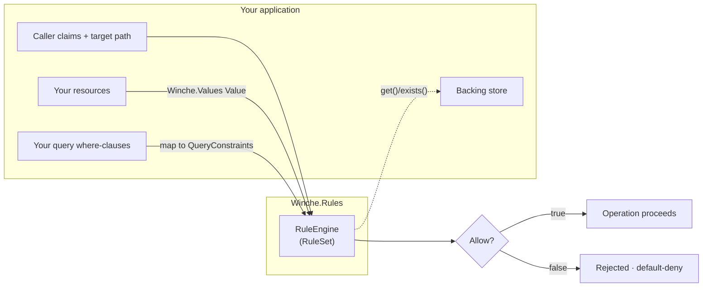
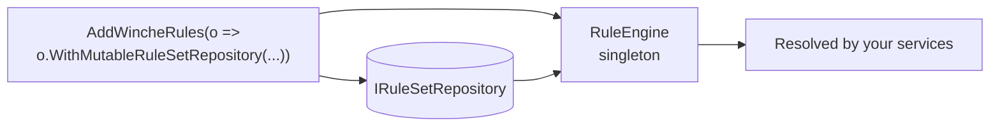
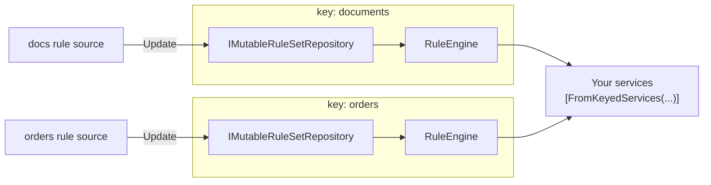
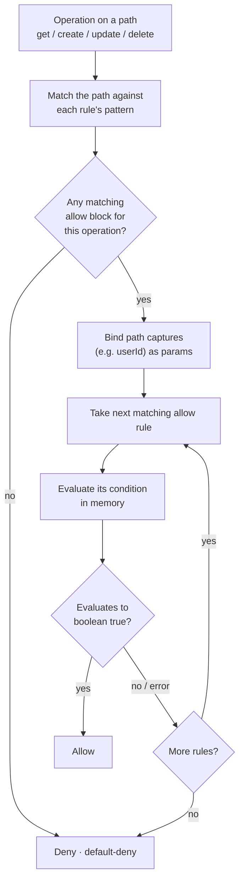
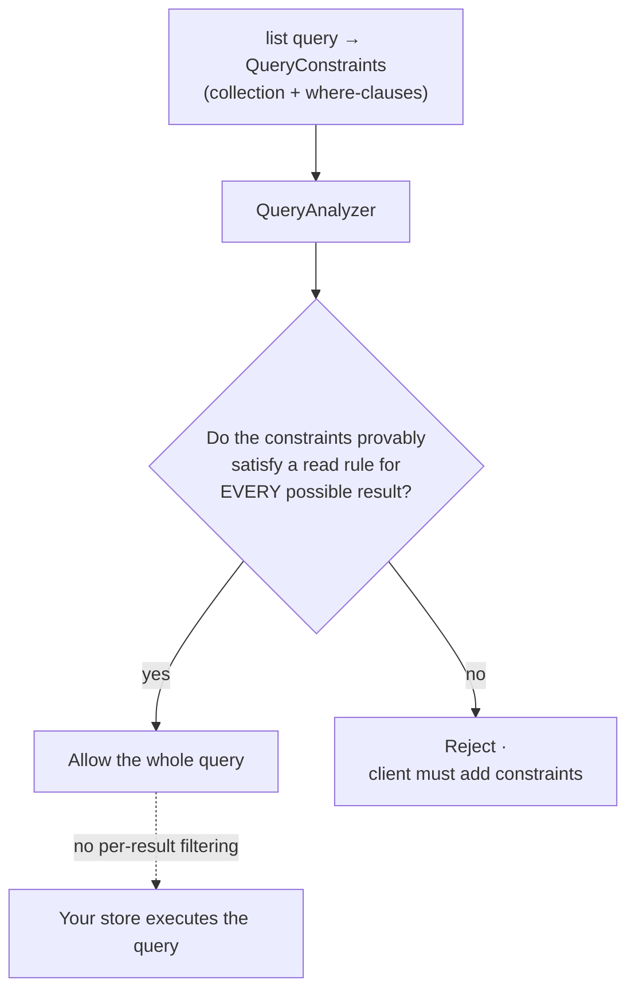

# Winche.Rules

[](https://www.nuget.org/packages/Winche.Rules)

A **standalone, declarative, JSON-serializable authorization rules engine** for .NET. You write access rules for path-based resources in a Firestore-style rules language (stored as JSON), and the engine evaluates them **in memory** — no backend call required. It is **backend-agnostic**: you connect it to your own resource store and query model through small adapter ports. Winche.Rules powers Winche.Database's access control, but it carries no dependency on that library (only on Winche.Core's shared value model) and can be used in any .NET project that authorizes resources addressed by path against per-request caller claims.

> **Writing rules?** Start with the **[Rules Language Guide](GUIDE.md)** — the syntax, what conditions can use,
> common patterns, how queries are checked, testing, and coming from Firebase. This README is the .NET API.

A "resource" here is anything you can address by a path — a record, a file, a row, an object — represented to the engine as a map of fields.

---

## Contents

1. [Core ideas](#core-ideas)
2. [How it works](#how-it-works)
3. [The value model](#the-value-model-winchevalues)
4. [Defining rules](#defining-rules)
5. [The engine](#the-engine-ruleengine)
6. [Dependency injection](#dependency-injection-addwincherules)
7. [Hot-swapping rules at runtime](#hot-swapping-rules-at-runtime)
8. [Evaluating single-resource operations](#evaluating-single-resource-operations)
9. [Authorizing queries (list)](#authorizing-queries-list)
10. [Cross-resource conditions (get / exists)](#cross-resource-conditions-get--exists)
11. [Comparison semantics](#comparison-semantics)
12. [Rules as data (JSON)](#rules-as-data-json)
13. [Pluggability — connecting your project](#pluggability--connecting-your-project)
14. [Composing rulesets](#composing-rulesets)
15. [Public API reference](#public-api-reference)
16. [Requirements and license](#requirements-and-license)

---

## Core ideas

Winche.Rules implements a declarative, path-based authorization model.

**Allow-only, default-deny, OR semantics.** Every rule is an `allow` — there is no `deny`. If no `allow` rule matches and evaluates to `true`, the operation is rejected. When multiple rules match a path, access is granted if *any one* of them evaluates to `true`.

**Rules are not filters.** This is the most important design point for `list`/query operations. The engine does **not** silently remove resources from a result set. Instead, it analyzes the query's constraints *before* execution and asks: "Does this query's shape provably guarantee that every result satisfies a read rule?" If yes, the query is allowed. If not, the query is **rejected** and the client must add the necessary constraints. This is the `QueryAnalyzer`, and it is *sound*: it only allows queries it can prove safe; it rejects anything it cannot prove, including rules that use `get()`/`exists()` or ternaries over document fields. (Conditions that don't depend on the documents at all are evaluated directly.)

**Single-resource operations** (`get`, `create`, `update`, `delete`) are evaluated by loading the resource and running the condition **in memory**. The engine never touches your backing store on its own; you hand it the pre-loaded resource.

**Evaluation semantics.** A condition grants only when it evaluates to boolean `true`. Any other outcome — a missing field, a type mismatch, null navigation — denies rather than throws. Errors are swallowed by the evaluator (fail-closed semantics).

---

## How it works

The engine sits between your application's request and your backing store. You adapt your types into the engine's neutral inputs; it returns an allow/deny decision.



---

## The value model (`Winche.Values`)

Rules evaluate directly on Winche.Core's shared value model (namespace `Winche.Values`, package `Winche.Core`) — the same values Winche.Database stores, so no conversion is needed. `Value` is an abstract record; a resource is a `MapValue` of field names to values.

```csharp
using Winche.Values;

// Scalars
new NullValue()
new BooleanValue(true)
new IntegerValue(42L)
new DoubleValue(3.14)
new StringValue("hello")
new BytesValue(byteArray)
new TimestampValue(DateTimeOffset.UtcNow)        // microsecond precision
new ReferenceValue("users/u1")                    // a path
new GeoPointValue(51.5, -0.12)                    // latitude, longitude

// Collections
new ArrayValue([new StringValue("a"), new StringValue("b")])
new MapValue(new Dictionary<string, Value>
{
    ["name"] = new StringValue("Alice"),
    ["age"]  = new IntegerValue(30),
})

// From plain .NET objects (e.g. claims)
Value auth = Value.FromObject(new Dictionary<string, object?> { ["uid"] = "u1" });
```

`Winche.Rules.RuleValues` adds the rules' view of values: `Null`, `True`, `False`, `Bool(bool)`, `Strings(IEnumerable<string>)`, `TypeName(Value)` (the rules-language type name: `string int float bool null map list timestamp bytes path latlng`), `AreEqual` and `TryCompare`.

Path captures bind as values too: `{id}` is a `StringValue`, a recursive `{rest=**}` a `ReferenceValue`; `path(...)` and `/a/b` literals are `ReferenceValue`s.

Numbers compare across `IntegerValue`/`DoubleValue` by numeric value. Comparison across other types is undefined and denies — see [Comparison semantics](#comparison-semantics).

---

## Defining rules

Rules are written in the rules language (see [Rules as text](#rules-as-text-310)) and parsed into a
`RuleSet` with `RuleText.ParseRuleSet`. In a Winche app they are edited in the console or deployed with
`winche rules deploy`; there is no C# builder (4.0.0 made `RuleSetBuilder` and `Expr` internal), so a
ruleset always has one source you can read, review and version.

```csharp
using Winche.Rules;
using Winche.Rules.Text;

RuleSet rules = RuleText.ParseRuleSet("""
    match users/{userId} {
      // Owner can read their own resource
      allow read: if resource.ownerId == request.auth.uid;
      // Owner can write (create/update/delete) to their own path
      allow write: if request.auth.uid == userId;

      // Nested match — public posts under each user
      match posts/{postId} {
        allow read;
      }
    }
    """);
```

Path patterns support:

- **Literal segments** — `users`
- **Single-segment capture** — `{userId}` (binds one path segment to a variable)
- **Recursive capture** — `{doc=**}`, one per path (counting the parents of nested matches). At the end
  (`users/{rest=**}`) it matches one or more segments — the rest of the path at any depth. At the start or in the
  middle (`{path=**}/posts/{postId}`, 3.1.0) it matches zero or more, so it covers `posts` under any parent,
  including a top-level one; its capture is those segments as a path.

Conditions can use `resource` (the **existing** resource), `request.resource` (the **incoming**, post-write
resource), `request.auth` (caller claims: `uid`, `token.role`, …), `request.time`, `request.method`, path
captures, literals, `exists(path)` / `get(path)` (need an `IRuleResourceProvider`) and the functions below.

A `RuleSet` from anywhere else (JSON you stored, say) can be checked with
`RuleSetValidation.Validate(ruleSet)`, which returns every structural problem (bad path, a nested match under a
recursive wildcard, two recursive wildcards in one path).

---

## Functions (3.1.0)

Besides `exists(path)` / `get(path)`, conditions can call these pure functions:

| Text | Meaning |
| --- | --- |
| `x.size()` | length of a string, list or map |
| `m.keys()` | a map's keys (sorted) |
| `l.hasOnly([...])` / `l.hasAll([...])` / `l.hasAny([...])` | every element of `l` is listed / `l` has all / any of them |
| `after.diff(before)` | how two maps differ; then `.affectedKeys()`, `.addedKeys()`, `.removedKeys()`, `.changedKeys()`, `.unchangedKeys()` |
| `x is string` | type check: `string int float number bool null map list timestamp bytes path latlng` |
| `s.matches('re')` | the whole string matches (100 ms limit; an invalid or slow regex denies) |
| `s.lower()` / `s.upper()` | case conversion |
| `m.get('key', default)` | the value at a key, or `default` when absent |
| `g.latitude` / `g.longitude` | a `latlng`'s coordinates (a map that merely has those keys is not a `latlng`) |

A wrong argument or type is an evaluation error, which denies — like a missing field.

For `list` queries, a condition that doesn't depend on the documents — only on `request`, path captures
bound by the collection path, literals and these functions — is now simply evaluated (e.g.
`request.auth.uid in ['admin1', 'admin2']`), instead of being rejected as unprovable.

## Readable forms (4.1.0)

The everyday checks have short forms. Each is shorthand for a method chain — it parses to the same
expression, so stored rules, the engine and query analysis are unchanged, and both spellings work:

| Readable form | Same as |
| --- | --- |
| `'role' not in request.resource.data` | `!('role' in request.resource.data)` |
| `request.resource.data has only ['name', 'email']` | `request.resource.data.keys().hasOnly(['name', 'email'])` |
| `request.resource.data has all ['name']` | `request.resource.data.keys().hasAll(['name'])` |
| `request.auth.token has any ['admin']` | `request.auth.token.keys().hasAny(['admin'])` |
| `changes only ['name', 'photoUrl']` | `request.resource.data.diff(resource.data).affectedKeys().hasOnly(['name', 'photoUrl'])` |
| `changes all [...]` / `changes any [...]` | `….affectedKeys().hasAll([...])` / `….hasAny([...])` |

```text
match users/{uid} {
  allow create: if request.auth.uid == uid
    && request.resource.data has only ['name', 'email']
    && 'role' not in request.resource.data;
  allow update: if request.auth.uid == uid && changes only ['name', 'photoUrl'];
}
```

`has` is about a **map's keys** (a document's fields, a token's claims); for a list use `x in list` or the
methods. `changes` compares the document after the write with the one before (database rules). They bind like
comparisons: looser than `!`, tighter than `&&`. Only these word pairs are special — `has`, `changes`, `not`,
`only`, `all` and `any` alone are still ordinary names. `RuleText.Format` / `FormatRuleSet` write the readable
forms; pass `readable: false` for the chains.

## Functions and paths (4.1.0)

Rules files can define functions — `function isOwner(uid) { let me = request.auth.uid; return me == uid; }`, at the
top level or inside a `match` — stored with the ruleset (`RuleSet.Functions`, `MatchBlock.Functions`; omitted from
JSON when there are none) and expanded into each condition before evaluation and query analysis. Paths can be
built: `get(/users/$(request.auth.uid))` is `get(path('users', request.auth.uid))` (Firebase's
`/databases/$(database)/documents/` prefix is ignored). `RuleSetValidation.Validate` checks function names,
argument counts and recursion; `RuleSetValidation.UnknownFunctions` lists calls to functions that don't exist where
they're called. See the [guide](GUIDE.md#writing-your-own-functions).

## Rules as text (3.1.0)

`RuleText.Parse(string)` and `RuleText.Format(RuleExpression)` convert conditions to and from a text form
close to Firestore's rules language — what the Winche console's rules editor uses:

```text
request.auth.token.sub == userId
  && request.resource.data has only ['name', 'email']      // comments run to the end of the line
  && request.resource.name is string
  && changes only ['name', 'email']
```

- Operators, loosest first: `c ? a : b`, `||`, `&&`, comparisons `== != < <= > >=` / `in` / `not in` / `is` /
  `has only|all|any` / `changes only|all|any`, `!`,
  then `.field`, `[index]` and method calls. `x.f(a)` is the same as `f(x, a)`.
- Literals: numbers, `'strings'` / `"strings"`, `true`, `false`, `null`, lists `[...]` and maps `{'k': v}` of
  constants, `timestamp('2027-01-01T00:00:00Z')`, `path('users/u1')`, `bytes('AAEC')`, `float('1e3')`.
- A name that isn't an identifier (or is a keyword) is written in backticks: ``resource.`odd name` ``.
- Errors are `RuleSyntaxException` with a 1-based `Line` and `Column`.

A whole ruleset can be written the same way, as one file — `RuleText.ParseRuleSet(string)` /
`RuleText.FormatRuleSet(RuleSet)`:

```text
match users/{uid} {
  allow read: if request.auth.uid == uid;
  allow create: if request.auth.uid == uid
    && request.resource.data has only ['name', 'email'];

  match notes/{noteId} {
    allow read, write: if request.auth.uid == uid;
  }
}
```

Operations are `get list create update delete`, plus `read` (get + list) and `write` (create + update +
delete). `allow get;` with no condition allows unconditionally (written back as `if true`). Nested `match`
paths extend their parent's. Comments are allowed but not kept: rules are stored as data.

Text and the JSON form round-trip: formatting then parsing gives the same expression, except that nested
`&&`/`||` are flattened and empty ones read back as `true`/`false`.

## The engine (`RuleEngine`)

`RuleEngine` is the recommended entry point. It reads its `RuleSet` from an `IRuleSetRepository` on every evaluation, evaluating over a per-request `RuleRequest`. Because it reads the ruleset per call, the rules can be hot-swapped (see [Hot-swapping rules at runtime](#hot-swapping-rules-at-runtime)).

```csharp
using Winche.Rules;
using Winche.Rules.Evaluation;
using Winche.Values;

// Frozen engine: wrap a fixed ruleset in a StaticRuleSetRepository.
var engine = new RuleEngine(new StaticRuleSetRepository(rules));

// Single-resource operation (get / create / update / delete)
bool allowed = await engine.AllowsAsync(
    RuleOperation.Get,
    "users/u1",
    new RuleRequest
    {
        Resource = new MapValue(new Dictionary<string, Value>
        {
            ["ownerId"] = new StringValue("u1"),
        }),
        Request = new MapValue(new Dictionary<string, Value>
        {
            ["method"] = new StringValue("get"),
            ["auth"]   = new MapValue(new Dictionary<string, Value> { ["uid"] = new StringValue("u1") }),
        }),
        // Provider is only needed when rules call get()/exists()
        Provider = null,
    });

// List / query authorization (static — never executes the query)
bool listAllowed = engine.Allows(constraints, new RuleRequest { Request = /* request map */ });
```

`RuleRequest` carries only the per-request inputs:

| Member | Meaning |
| - | - |
| `Resource` | The existing resource as a `MapValue` (whatever field shape your rules navigate), or `RuleValues.Null`. |
| `Request` | The request map — `auth`, `method`, `time`, and `resource` (the incoming map) as needed. |
| `Params` | Extra params (`IReadOnlyDictionary<string, Value>`); path-pattern captures bound by the engine take precedence. Defaults to none. |
| `Provider` | An `IRuleResourceProvider` for `get()`/`exists()`; `null` when no rule uses them. |

> The static entry points `RuleSetEvaluator.AllowsAsync` and `QueryAnalyzer.Allows` (which take a `RuleContext`) remain available as a lower-level API — `RuleEngine` is a thin facade over them. See [Evaluating single-resource operations](#evaluating-single-resource-operations).

---

## Dependency injection (`AddWincheRules`)

The `Winche.Rules.DependencyInjection` namespace registers a configured `RuleEngine` as a singleton. Besides Winche.Core, it depends only on `Microsoft.Extensions.DependencyInjection.Abstractions`.

```csharp
using Winche.Rules.DependencyInjection;

var ruleset = RuleText.ParseRuleSet("""
    match users/{userId} {
      allow read: if resource.ownerId == request.auth.uid;
    }
    """);

services.AddWincheRules(o => o
    .WithMutableRuleSetRepository(ruleset));   // hot-swappable; or WithStaticRuleSetRepository(ruleset) for a frozen engine

// elsewhere
var engine = provider.GetRequiredService<RuleEngine>();
```

`WincheRulesOptions` is a fluent builder: `WithMutableRuleSetRepository(RuleSet?)` (hot-swappable), `WithStaticRuleSetRepository(RuleSet)` (frozen), and `WithRuleSetRepository(IRuleSetRepository)` (your own source). The non-keyed overload registers a single `RuleEngine` over the configured repository (no cross-ruleset merge); it is registered with `TryAddSingleton`. If the repository is mutable, its `IMutableRuleSetRepository` write side is registered too, so you can hot-swap even the non-keyed engine.

> For **per-type isolation** — one independent engine per resource type — use the keyed overload `AddWincheRules(serviceKey, …)` — see [Hot-swapping rules at runtime](#hot-swapping-rules-at-runtime). Keyed registrations are **never** merged: each key is an independent engine with its own ruleset.



---

## Hot-swapping rules at runtime

An engine reads its ruleset from an `IRuleSetRepository` on **every** evaluation, so you can replace a
running engine's rules — from a file, database, admin endpoint, or message — **without recompiling or
restarting**. The seam is read/write-separated:

| Type | Role |
| - | - |
| `IRuleSetRepository` | Read side — `RuleSet Current { get; }`. The engine depends only on this. |
| `IMutableRuleSetRepository` | Write side — adds `void Update(RuleSet)`. Reload/admin code depends on this. |
| `MutableRuleSetRepository` | Hot-swappable implementation: a lock-free `volatile` reference swap. |
| `StaticRuleSetRepository` | Immutable implementation: a fixed ruleset (a frozen engine). |

Because a `RuleSet` is immutable, `Update` is a single atomic reference write: an in-flight evaluation
keeps the snapshot it started with, and the next one observes the new rules — no locks.

```csharp
var repo   = new MutableRuleSetRepository(initialRules);
var engine = new RuleEngine(repo);

bool before = await engine.AllowsAsync(RuleOperation.Get, "docs/d1", request);  // e.g. false

repo.Update(newRules);   // hot-swap — same engine instance, no restart

bool after  = await engine.AllowsAsync(RuleOperation.Get, "docs/d1", request);  // e.g. true
```

### One independent engine per resource type (keyed DI)

When a consumer runs the library for **multiple resource types**, each type typically has its own rule
source and its own reload cadence. Register one **keyed** engine per type
with `AddWincheRules(serviceKey, …)`. Keyed registrations are fully isolated — **never merged** — each
with its own ruleset and (when mutable) its own `IMutableRuleSetRepository`.

```csharp
using Microsoft.Extensions.DependencyInjection;
using Winche.Rules.DependencyInjection;

var documentsRules = RuleText.ParseRuleSet("""
    match documents/{id} {
      allow read: if resource.ownerId == request.auth.uid;
    }
    """);

services.AddWincheRules("documents", o => o
    .WithMutableRuleSetRepository(documentsRules));

services.AddWincheRules("orders", o => o
    .WithStaticRuleSetRepository(ordersRules));    // frozen

// Evaluate — inject the engine for a type by key:
public sealed class DocumentService([FromKeyedServices("documents")] RuleEngine engine) { /* ... */ }

// Reload one type's rules at runtime — other types are untouched:
public sealed class DocumentRuleAdmin([FromKeyedServices("documents")] IMutableRuleSetRepository repo)
{
    public void Apply(RuleSet freshlyLoadedRules) => repo.Update(freshlyLoadedRules);
}
```

A key registered with `WithStaticRuleSetRepository(...)` is **frozen**: no `IMutableRuleSetRepository` is
registered for it, so resolving one returns `null` — hot-swap is unavailable by design. Use
`WithMutableRuleSetRepository(...)` for a hot-swappable key. For a source that refreshes itself (e.g. a file
watcher), implement `IRuleSetRepository` yourself and pass it with `WithRuleSetRepository(myRepository)`; if
it also implements `IMutableRuleSetRepository`, its write side is registered under that key too.

> **Why a mutable repository is registered under two interfaces.** For a hot-swappable key, the *same*
> `MutableRuleSetRepository` **instance** is registered twice — once as `IRuleSetRepository` (what the engine
> reads on every evaluation) and once as `IMutableRuleSetRepository` (what reload/admin code writes through
> `Update`). Registering one instance under both service types gives you read/write separation at the type
> level — evaluators inject the read-only interface and can't mutate rules — while guaranteeing that an
> `Update` on the write side is the very object the engine reads, so the swap is seen immediately. A
> *frozen* (`StaticRuleSetRepository`) key is registered only as `IRuleSetRepository`, so there is no write
> side at all.



---

## Evaluating single-resource operations

The lower-level static API for `get`, `create`, `update`, and `delete` is `RuleSetEvaluator.AllowsAsync`, which takes a `RuleContext`. For `list` (queries), use `QueryAnalyzer` instead (see the next section).



```csharp
using Winche.Rules;
using Winche.Rules.Evaluation;

bool allowed = await RuleSetEvaluator.AllowsAsync(
    rules,
    RuleOperation.Get,
    "users/u1",         // the full path being accessed
    context);
```

### Building a `RuleContext`

`RuleContext` carries everything the condition needs. Its values are `Winche.Values` values — if your store already uses them, pass them straight through.

```csharp
var context = new RuleContext
{
    // The existing resource as a map — its field layout is entirely yours.
    // Set to RuleValues.Null when the resource does not exist (e.g. for a create).
    Resource = new MapValue(new Dictionary<string, Value>
    {
        ["ownerId"] = new StringValue("u1"),
    }),

    // The request object — a map with at minimum "auth" and "method"
    Request = new MapValue(new Dictionary<string, Value>
    {
        ["method"]   = new StringValue("get"),
        ["auth"]     = new MapValue(new Dictionary<string, Value> { ["uid"] = new StringValue("u1") }),
        // Include "resource" (the post-write map) for create/update
        ["resource"] = RuleValues.Null,
    }),

    // Optionally pass extra params (path captures added by the evaluator take precedence)
    Params = RuleContext.NoParams,

    // Implement IRuleResourceProvider only when rules use get()/exists()
    Provider = null,
};
```

The evaluator matches the path against each rule's path pattern, binds the captured segments (e.g. `userId` from `users/{userId}`) as params, then evaluates the condition. It returns `true` if any matching `allow` rule evaluates to `true`; otherwise `false` (default-deny).

---

## Authorizing queries (`list`)

**Collection group queries (3.1.0).** `new QueryConstraints("posts", constraints, CollectionGroup: true)` is a
query over every `posts` collection, under any parent. Only rules that cover every parent govern it:
`{path=**}/posts/{postId}`, `{path=**}/{coll}/{doc}` (with `coll` bound to `posts`), or a bare `{path=**}`.
The parents' capture is per result, so a condition on it can't be proven.

`QueryAnalyzer.Allows` (or `RuleEngine.Allows`) performs static analysis: it proves that the query's constraints are sufficient to satisfy a read rule for every possible result. It never executes the query.



```csharp
using Winche.Rules;
using Winche.Rules.Evaluation;
using Winche.Rules.Expressions;
using Winche.Rules.Querying;
using Winche.Rules.Text;
using Winche.Values;

// Rule: allow read if resource.ownerId == request.auth.uid
RuleSet rules = RuleText.ParseRuleSet("""
    match users/{userId} {
      allow read: if resource.ownerId == request.auth.uid;
    }
    """);

// Map each of your query's where-clauses to a QueryConstraint.
// The field path matches how your rule navigates the resource (here: resource.ownerId).
var constrainedQuery = new QueryConstraints(
    collection: "users",
    constraints: [new QueryConstraint(["ownerId"], ComparisonOperator.Eq, new StringValue("u1"))]);

var openQuery = new QueryConstraints("users", []);

var context = new RuleContext
{
    Request = new MapValue(new Dictionary<string, Value>
    {
        ["method"] = new StringValue("list"),
        ["auth"]   = new MapValue(new Dictionary<string, Value> { ["uid"] = new StringValue("u1") }),
    }),
};

bool allowed  = QueryAnalyzer.Allows(rules, constrainedQuery, context);  // true  — ownerId == uid proven
bool rejected = QueryAnalyzer.Allows(rules, openQuery,        context);  // false — unconstrained, rejected
```

A query is allowed only when the analyzer can prove, from the constraints alone, that the condition holds for every resource the query could return. An unconstrained query against an owner-filtered rule is always rejected — the client must add the `where` clause.

The analyzer handles:

- Equality pinning (`ownerId == "u1"` proves `ownerId == auth.uid` when `uid == "u1"`)
- Exact range match (query `age >= 18` proves rule `age >= 18`)
- `OR` rules (a query that proves either branch is allowed)
- Subcollections with bound parent captures
- Recursive wildcards (`{doc=**}`)

The analyzer **rejects** (returns `false`) for any rule or query it cannot prove, including those involving `get()`/`exists()`, `in`, ternaries, or per-result path wildcards compared against `auth.uid`.

> **Soundness note.** The analyzer's proof is only as faithful as its comparison of values. Rules compare exactly as Winche.Database orders (`ValueComparer.Instance`), so its proofs agree with that store. If you embed Winche.Rules in a different store, its equality/ordering must match the database's order — otherwise the prover could declare a query safe whose real result set differs. See [Comparison semantics](#comparison-semantics).

---

## Cross-resource conditions (`get` / `exists`)

Rules can reference **other** resources via `get(path)` and `exists(path)`. You back these by implementing `IRuleResourceProvider`:

```csharp
using Winche.Rules;
using Winche.Rules.Evaluation;
using Winche.Values;

public sealed class MyResourceProvider(IMyStore store) : IRuleResourceProvider
{
    public async Task<bool> ExistsAsync(string path, CancellationToken ct = default)
        => await store.ExistsAsync(path, ct);

    public async Task<Value> GetAsync(string path, CancellationToken ct = default)
    {
        var item = await store.GetAsync(path, ct);
        if (item is null) return RuleValues.Null;
        return Value.FromObject(item.Fields);   // or build a MapValue; pass Winche.Values maps straight through
    }
}
```

Pass an instance as `RuleRequest.Provider` (or `RuleContext.Provider`). When a rule calls `exists(path)` or `get(path)`, the evaluator delegates to this interface. Reads should be scoped to the current request, cached, and capped to prevent unbounded lookups.

```csharp
// Rule: allow read if the user's team resource is active
RuleSet rules = RuleText.ParseRuleSet("""
    match docs/{id} {
      allow read: if exists('teams/t1') && get('teams/t1').active == true;
    }
    """);

var engine = new RuleEngine(new StaticRuleSetRepository(rules));
bool allowed = await engine.AllowsAsync(RuleOperation.Get, "docs/d1", new RuleRequest
{
    Request  = /* ... */,
    Provider = new MyResourceProvider(store),
});
```

Note: `QueryAnalyzer` **always rejects** queries against rules that use `get()`/`exists()` — cross-resource lookups cannot be proven statically.

---

## Comparison semantics

Equality (`==`, `!=`, `in`) and ordering (`<`, `<=`, `>`, `>=`) are fixed — there is no plug point. Rules compare exactly as the database orders values (`ValueComparer.Instance`), so the query analyzer's proofs agree with the store:

- **Equal** (`RuleValues.AreEqual`) — same type (ints and floats are both numbers) and equal under `ValueComparer`. Values of different types are never equal.
- **Ordered** (`RuleValues.TryCompare`) — values of the same type order as the database orders them; different types, or NaN, have no order, and ordering them is an error (which denies).

---

## Rules as data (JSON)

RuleSets and expressions are fully serializable. Use `RuleJson` for round-trips:

```csharp
using Winche.Rules;
using Winche.Rules.Json;

// Serialize
string json = RuleJson.Serialize(rules);

// Deserialize
RuleSet restored = RuleJson.DeserializeRuleSet(json);

// Expression round-trip
string exprJson          = RuleJson.Serialize(RuleText.Parse("resource.ownerId == request.auth.uid"));
RuleExpression restored2 = RuleJson.DeserializeExpr(exprJson);
```

Expression nodes use a `kind` discriminator: `"literal"`, `"variable"`, `"member"`, `"index"`, `"comparison"`, `"and"`, `"or"`, `"not"`, `"in"`, `"conditional"`, `"call"`. Literal values (`LiteralExpression.Value`) are written by `RuleLiteralJsonConverter` (also in `RuleJson.Options`): natural JSON for common types and tagged single-key objects for types JSON cannot faithfully represent. (Winche.Core's own `Value` JSON converter is the database wire format — a different shape.)

| Value | JSON representation |
| - | - |
| `NullValue` | `null` |
| `BooleanValue` | `true` / `false` |
| `StringValue` | `"..."` |
| `ArrayValue` | `[...]` |
| `MapValue` | `{...}` |
| `IntegerValue` | `{"$integer":"42"}` |
| `DoubleValue` | `{"$double":3.14}` |
| `TimestampValue` | `{"$timestamp":"2025-01-01T00:00:00+00:00"}` |
| `BytesValue` | `{"$bytes":"<base64>"}` |
| `ReferenceValue` | `{"$path":"users/u1"}` |
| `GeoPointValue` | `{"$latlng":[51.5,-0.12]}` |

Map field names must not begin with `$` (it is reserved for the tagged-value encoding above).

---

## Pluggability — connecting your project

The engine needs a few adapters, all of which you provide:

1. **Entity → `Value`** — if your store already uses `Winche.Values`, there is nothing to convert. Otherwise build a `MapValue` (or use `Value.FromObject`) for each resource. The map's field layout is entirely yours; your rules navigate whatever keys you put in it. No interface is required.

2. **Query → `QueryConstraints`** — map each `where` clause of your query to a `QueryConstraint(fieldPath, op, value)` and wrap them in a `QueryConstraints(collection, constraints)`.

3. **Store → `IRuleResourceProvider`** — implement `ExistsAsync`/`GetAsync` over your backing store. Only required when rules use `get()`/`exists()`.

The engine fits any system that has **resources addressed by path** and **per-request caller claims**. The caller claims shape is whatever you put in `request.auth`; the conditions reference it as `request.auth`.

---

## Composing rulesets

`RuleSet.Merge` concatenates the match blocks from multiple rulesets into one. Because evaluation uses OR/default-deny semantics, block order does not affect the authorization decision — a request is allowed if any block grants it.

```csharp
var merged = RuleSet.Merge([usersRuleSet, ordersRuleSet, adminRuleSet]);

// An empty sequence returns a deny-all ruleset
var denyAll = RuleSet.Merge([]);
```

This is useful for assembling per-module rulesets at startup, or for merging a base ruleset with an override layer, before handing the result to a repository. (`AddWincheRules` does **not** merge across registrations — each registration is one independent engine; compose with `RuleSet.Merge` yourself if you want one engine over several rulesets.)

---

## Public API reference

### `Winche.Rules`

| Type | Role |
| - | - |
| `RuleValues` | Static: `Null`, `True`, `False`, `Bool(bool)`, `Strings(IEnumerable<string>)`, `TypeName(Value)`, `AreEqual(Value, Value)`, `TryCompare(Value, Value, out int)`. |
| `RuleSet` | Immutable record: `IReadOnlyList<MatchBlock> Matches`. `static Merge(IEnumerable<RuleSet>)`. |
| `MatchBlock` | `(string Path, IReadOnlyList<AllowRule> Allow, IReadOnlyList<MatchBlock> Matches)` |
| `AllowRule` | `(IReadOnlyList<RuleOperation> Operations, RuleExpression Condition)` |
| `RuleOperation` | Enum: `Get`, `List`, `Create`, `Update`, `Delete`. |
| `RuleOperations` | Static sets: `Read`, `Write`, `All`, `Of(params RuleOperation[])`. |
| `RuleSetValidation` | `static Validate(RuleSet)` → `IReadOnlyList<RuleValidationIssue>` `(string? Path, string Message)`; empty when valid. |
| `RuleEngine` | `RuleEngine(IRuleSetRepository)`. `Task<bool> AllowsAsync(RuleOperation, string path, RuleRequest, CancellationToken)`; `bool Allows(QueryConstraints, RuleRequest)`. Reads the ruleset from the repository per call. |
| `IRuleSetRepository` | Read side of the ruleset seam: `RuleSet Current { get; }`. |
| `IMutableRuleSetRepository` | Write side: `IRuleSetRepository` + `void Update(RuleSet)`. |
| `MutableRuleSetRepository` | Hot-swappable `IMutableRuleSetRepository`: `MutableRuleSetRepository(RuleSet?)`, lock-free atomic swap. |
| `StaticRuleSetRepository` | Immutable `IRuleSetRepository`: `StaticRuleSetRepository(RuleSet)` — a frozen engine. |
| `RuleSetEvaluator` | Low-level: `static Task<bool> AllowsAsync(RuleSet, RuleOperation, string path, RuleContext, CancellationToken)`. |

### `Winche.Values` (Winche.Core)

The value types rules evaluate on: `Value` and its records `NullValue`, `BooleanValue`, `IntegerValue`, `DoubleValue`, `StringValue`, `BytesValue`, `TimestampValue`, `ReferenceValue`, `GeoPointValue`, `ArrayValue`, `MapValue`; `Value.FromObject(object?)`, `ValueComparer.Instance`, `PlainJson.Of(value)`. See Winche.Core.

### `Winche.Rules.Expressions`

| Type | Role |
| - | - |
| `RuleExpression` | Abstract base record for all expression nodes. |
| `LiteralExpression` | `(Value Value)` |
| `VarExpression` | `(string Name)` |
| `MemberExpression` | `(RuleExpression Target, string Name)` |
| `IndexExpression` | `(RuleExpression Target, RuleExpression Index)` |
| `CompareExpression` | `(RuleExpression Left, ComparisonOperator Op, RuleExpression Right)` |
| `AndExpression` | `(IReadOnlyList<RuleExpression> Operands)` |
| `OrExpression` | `(IReadOnlyList<RuleExpression> Operands)` |
| `NotExpression` | `(RuleExpression Operand)` |
| `InExpression` | `(RuleExpression Item, RuleExpression Collection)` |
| `ConditionalExpression` | `(RuleExpression Condition, RuleExpression Then, RuleExpression Else)` |
| `CallExpression` | `(string Name, IReadOnlyList<RuleExpression> Args)` |
| `ComparisonOperator` | Enum: `Eq`, `Ne`, `Lt`, `Le`, `Gt`, `Ge`. |

### `Winche.Rules.Evaluation`

| Type | Role |
| - | - |
| `RuleEngine` *(in `Winche.Rules`)* | High-level engine; see above. |
| `RuleRequest` | Per-request inputs: `Resource`, `Request`, `Params`, `Provider`. |
| `RuleEvaluator` | `static Task<bool> EvaluateAsync(RuleExpression, RuleContext, CancellationToken)`. |
| `RuleContext` | `Resource`, `Request` (`Value`), `Params` (`IReadOnlyDictionary<string, Value>`), `Provider`. `static NoParams`. |
| `IRuleResourceProvider` | `Task<bool> ExistsAsync(string, CancellationToken)` + `Task<Value> GetAsync(string, CancellationToken)`. |
| `RuleEvaluationException` | Thrown internally on evaluation errors; caught by the evaluator which returns `false`. |

### `Winche.Rules.Querying`

| Type | Role |
| - | - |
| `QueryAnalyzer` | `static bool Allows(RuleSet, QueryConstraints, RuleContext)`. |
| `QueryConstraints` | `(string Collection, IReadOnlyList<QueryConstraint> Constraints)`. |
| `QueryConstraint` | `(IReadOnlyList<string> Field, ComparisonOperator Operator, Value Value)`. |

### `Winche.Rules.Json`

| Type | Role |
| - | - |
| `RuleJson` | `Serialize(RuleExpression)`, `DeserializeExpr(string)`, `Serialize(RuleSet)`, `DeserializeRuleSet(string)`. `static JsonSerializerOptions Options`. |
| `RuleLiteralJsonConverter` | `System.Text.Json` converter for rule literals (`{"$integer":"5"}`, `{"$latlng":[lat,lng]}`, …); applied on `LiteralExpression.Value` and in `RuleJson.Options`. |

### `Winche.Rules.DependencyInjection`

| Type | Role |
| - | - |
| `ServiceCollectionExtensions` | `AddWincheRules(this IServiceCollection, Action<WincheRulesOptions>)` — one non-keyed singleton `RuleEngine`. `AddWincheRules(this IServiceCollection, object serviceKey, Action<WincheRulesOptions>)` — one isolated keyed engine per type. |
| `WincheRulesOptions` | Fluent: `WithMutableRuleSetRepository(RuleSet?)`, `WithStaticRuleSetRepository(RuleSet)`, `WithRuleSetRepository(IRuleSetRepository)`. |

---

## Requirements and license

**Target framework:** .NET 10 (`net10.0`)

**Dependencies:** Winche.Core (path patterns, values) and `Microsoft.Extensions.DependencyInjection.Abstractions`.

**License:** [Elastic License 2.0](https://www.elastic.co/licensing/elastic-license) — see `LICENSE`.
